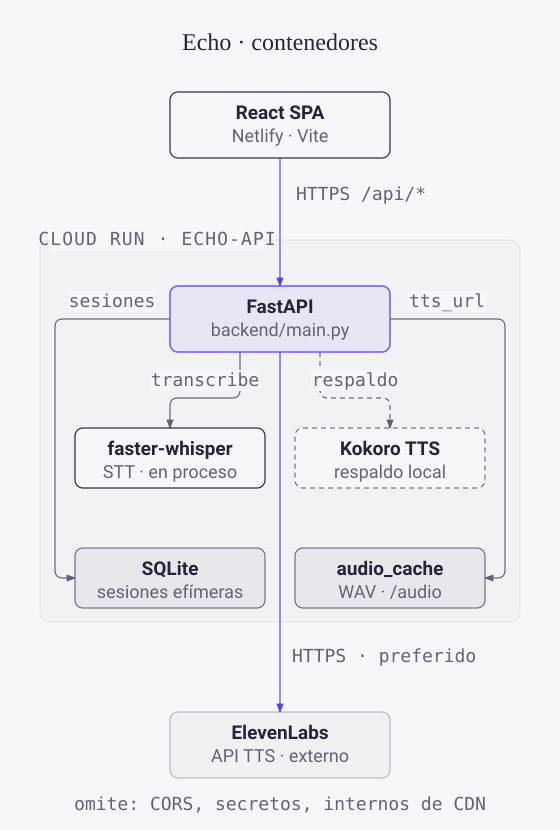

<p align="center">
  <picture>
    <source media="(prefers-color-scheme: dark)" srcset="docs/assets/mark-dark.svg">
    
  </picture>
</p>

<h1 align="center">Echo</h1>

<p align="center">
  Practica pronunciación con oraciones reales, obtén un score por palabra<br>
  y escucha cómo debe sonar.
</p>

<p align="center">
  <a href="https://echo-pronunciation.netlify.app/">Demo en vivo</a> ·
  <a href="docs/ARCHITECTURE.md">Arquitectura</a> ·
  <a href="docs/DEPLOY.md">Deploy</a> ·
  <a href="README.md">English</a> · <strong>Español</strong>
</p>

> El demo es público y no tiene cuentas. Las sesiones y el progreso viven en un filesystem efímero de Cloud Run y pueden desaparecer cuando la instancia se recicla.

El navegador te graba; un backend chico en FastAPI transcribe, califica y sintetiza el audio de referencia.

## Qué puedes hacer

- Elegir idioma (inglés, español, mandarín) y nivel CEFR en la pantalla de inicio
- Grabarte leyendo una oración y recibir un score con desglose por palabra
- Escuchar el audio de referencia y comparar waveforms
- Practicar mandarín con overlay de pinyin y feedback de tono por sílaba
- Seguir rachas y precisión en la página de progreso

## Cómo funciona

<p align="center">
  <picture>
    <source media="(prefers-color-scheme: dark)" srcset="docs/assets/echo-arch.dark.es.svg">
    
  </picture>
</p>

<p align="center"><sub>
  Vista de contenedores, generada desde el <a href="docs/assets/echo-arch.model.yaml">modelo verificado</a>: cada nodo y arista traza a código fuente.
</sub></p>

1. El SPA en React graba el audio en el navegador ([`frontend/src/hooks/useMicrophone.ts`](frontend/src/hooks/useMicrophone.ts)) y lo manda a `POST /api/practice/analyze` en [`backend/main.py`](backend/main.py).
2. El backend convierte el audio con ffmpeg, lo transcribe con faster-whisper ([`backend/whisper_service.py`](backend/whisper_service.py)) y lo califica contra la oración objetivo ([`backend/scoring.py`](backend/scoring.py)). El mandarín se califica por carácter y por tono, del lado del cliente.
3. El audio de referencia viene de ElevenLabs si hay llave configurada, si no de Kokoro TTS local ([`backend/elevenlabs_service.py`](backend/elevenlabs_service.py), [`backend/kokoro_service.py`](backend/kokoro_service.py)). Los WAV quedan cacheados bajo `/audio`.
4. Las sesiones caen en SQLite ([`backend/database.py`](backend/database.py)) y alimentan la página de progreso.

## Levantarlo en local

Necesitas Node 20+, Python 3.11+ y ffmpeg.

```sh
cd backend
python -m venv .venv && source .venv/bin/activate
pip install -r requirements.txt   # incluye torch; la descarga es pesada
cp .env.example .env              # ELEVENLABS_API_KEY opcional, cae a Kokoro

cd ../frontend
npm install
cd ..

bash scripts/dev-start.sh         # backend :8000, frontend :5173
```

Abre http://localhost:5173. Sin `VITE_API_ORIGIN`, el dev server de Vite hace proxy de `/api` y `/audio` al backend local. Docs de la API en http://localhost:8000/docs.

## Estructura

| Carpeta | Qué hay dentro |
| --- | --- |
| `frontend/` | SPA en React 19 + TypeScript + Vite (Tailwind, react-router, TanStack Query, Recharts, Framer Motion) |
| `backend/` | Servicio FastAPI: transcripción, scoring, TTS, persistencia en SQLite |
| `scripts/` | `dev-start.sh`, deploy a Cloud Run, tests de humo y de carga |
| `docs/` | [ARCHITECTURE](docs/ARCHITECTURE.md), [DEPLOY](docs/DEPLOY.md), [HANDOFF](docs/HANDOFF.md), [TESTING_GUIDE](docs/TESTING_GUIDE.md) (en inglés) |

## Tests

```sh
cd backend && python -m pytest tests/ -q          # unit tests de scoring y caché TTS
cd frontend && npx tsc --noEmit && npm run build  # typecheck + build
```

CI corre el typecheck, los unit tests y un scan de secretos con gitleaks en cada push y PR.

## Deployment

- El frontend se despliega solo a Netlify desde `main` (`netlify.toml`).
- El backend se despliega a Cloud Run desde `.github/workflows/echo-cd.yml`, autenticado con Workload Identity Federation, sin llaves persistentes. La receta está en [docs/DEPLOY.md](docs/DEPLOY.md).

## Diseño

Design system Clinical Sublime (familia Positronica): primario lavanda, Orbitron + Inter, glassmorphism, modo oscuro. Tokens en `frontend/src/index.css`.

## Créditos

- [faster-whisper](https://github.com/SYSTRAN/faster-whisper) — transcripción
- [Kokoro](https://github.com/hexgrad/kokoro) — TTS local
- [ElevenLabs](https://elevenlabs.io) — TTS en la nube

## Licencia

[MIT](LICENSE)
